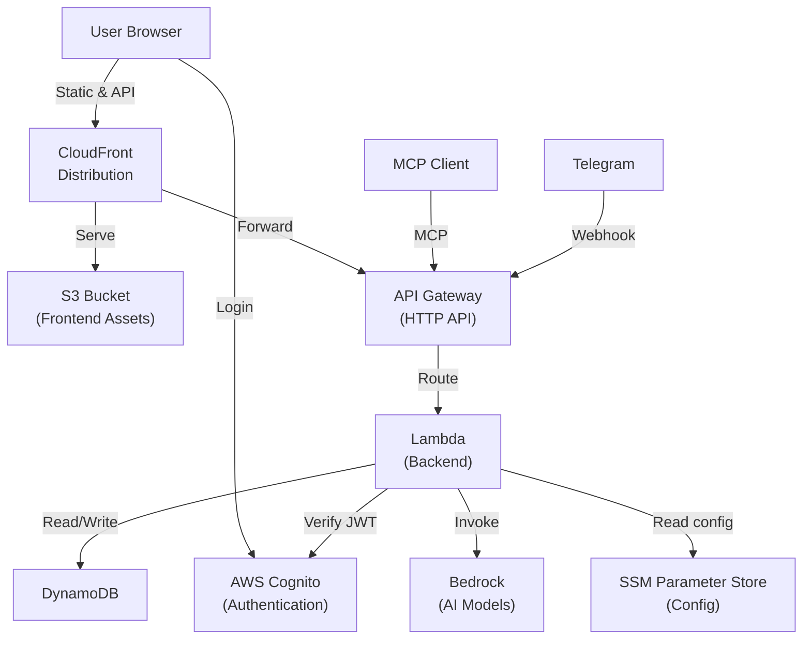
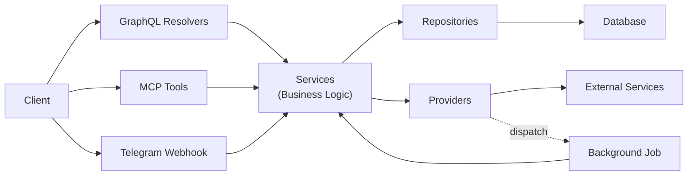

# Personal Finance Tracker Constitution

## Repository Structure

### Overview

The project has 3 independent npm packages:

- **backend** – API for all clients, business logic, and data storage
- **frontend** – Single-page web application
- **infra-cdk** – Deployable infrastructure for the backend, the frontend, and authentication

### Backend

This npm package contains the GraphQL API (Apollo Server), the MCP server, the Telegram bot webhook, and AI agents.

**Technologies**:

- **Language**: TypeScript
- **API**: Apollo Server (GraphQL), MCP SDK
- **AI Agents**: LangChain
- **Database**: DynamoDB

**Responsibilities**:

- **Business Logic**: Implement domain rules in domain entities and services
- **GraphQL API**: Give the frontend access to data and operations through GraphQL resolvers
- **MCP API**: Give external AI agents access to user data through MCP tools
- **Telegram Bot**: Answer Telegram messages through an AI agent
- **AI Agents**: Run AI agents that answer user questions and create transactions from text
- **Database Access**: Store and read all data
- **Authentication**: Verify the credentials of each caller to find the matching user
- **Authorization**: Prevent access to the data of other users

### Frontend

This npm package contains the single-page web application.

**Technologies**:

- **Language**: TypeScript
- **UI**: Vue 3, Vuetify
- **API Client**: Apollo Client (GraphQL)
- **Build**: Vite

**Responsibilities**:

- **User Interface**: Let the user see and change their data
- **Authentication**: Let the user sign in
- **API Access**: Connect to the backend through the GraphQL API
- **Localization**: Show the interface in the language of the user
- **PWA**: Let the user install the app on a mobile device without an app store

### Infra CDK

This npm package contains the AWS infrastructure code for the whole project.

**Technologies**:

- **Language**: TypeScript
- **Infrastructure as Code**: AWS CDK

**Responsibilities**:

- **Backend Infrastructure**: Create the DynamoDB tables, the Lambda functions, and the API Gateway
- **Frontend Infrastructure**: Create the S3 bucket and the CloudFront distribution
- **Authentication Infrastructure**: Create the Cognito user pool
- **Deployment**: Deploy all stacks from one CDK app

## General Requirements

- Use only free-tier or pay-per-use cloud services
- Make the app installable on mobile devices as a PWA, without an app store
- Minimize vendor lock-in (see [Vendor Independence](#vendor-independence))

## Infrastructure and Environments

### Production

**AWS Services**:

- **CloudFront**: Serve the frontend over HTTPS and forward API requests to API Gateway
- **S3**: Store the frontend build
- **API Gateway**: Route GraphQL, MCP, and Telegram webhook requests to Lambda
- **Lambda**: Run the backend
- **DynamoDB**: Store user data
- **Cognito**: Sign in users and issue JWT tokens
- **Bedrock**: Run the AI models for the AI agents
- **SSM Parameter Store**: Keep runtime configuration and secrets

**Deployment**:

- Deploy manually with `deploy.sh`

### Development

**Local Services**:

- **Vite Dev Server**: Serve the frontend instead of S3 and CloudFront
- **Express Server**: Run the GraphQL API and the MCP API instead of API Gateway and Lambda
- **DynamoDB Local**: Store user data in Docker instead of AWS DynamoDB
- **`.env` File**: Keep runtime configuration and secrets instead of SSM Parameter Store

**AWS Services**:

- **Cognito**: Use a deployed user pool with `localhost` in its callback URLs
- **Bedrock**: Call the AI models with an API key from the `.env` file

**Limitations**:

- The Telegram webhook is not available
- Background jobs do not run

## Core Principles

### Vendor Independence

**Non-negotiable rule**: Choose technologies and an architecture that let the app move to a different provider.

- **Frontend**: Keep the frontend deployable to any static host, such as S3 or nginx, without code changes
- **Backend**: Keep the backend deployable to any Node.js runtime, such as AWS Lambda or Docker, without code changes
- **Database**: Access the database through abstractions so that a different database can replace it
  - Use the repository pattern for all database operations
  - Use only database operations that other popular SQL and NoSQL databases also support
  - Avoid vendor-specific features and optimizations
- **External Services**: Access external services through abstractions
- **Authentication**: Use standard OpenID Connect and JWT so that a configuration change can replace the identity provider
- **Configuration**: Read runtime configuration only from environment variables
  - Load values from an external store into environment variables
- **Infrastructure Code**: CDK is AWS-specific, but the frontend and the backend stay portable

### Schema-Driven Development

**Non-negotiable rule**: The GraphQL schema is the single source of truth for the GraphQL API contract. Start every API change with a change to the schema.

**Schema Files**:

- **Backend**: `backend/src/graphql/schema.graphql` is the source schema
- **Frontend**: `frontend/src/schema.graphql` is a copy of the backend schema

**Development Process**:

1. Read the backend schema before an API change
2. Change the backend schema
3. Generate the backend types with `npm run codegen` in `backend`
4. Write the GraphQL operations in `frontend/src/graphql`
5. Generate the frontend types with `npm run codegen` in `frontend`
6. Use the generated types in the backend and frontend code

### Backend Hexagonal Architecture

**Non-negotiable rule**: Use a hexagonal architecture in the backend. Keep the business logic in the core. Make all dependencies point to the core.

**Core**:

- **Domain** (`src/models`)
  - Define the entities and their invariants
  - Do not call other layers
- **Services** (`src/services`)
  - Implement the business operations and validations
  - Call the domain, ports, and other services
- **Ports** (`src/ports`)
  - Define the interfaces that services use to access the database and external services

**Inbound Adapters**:

- **GraphQL** (`src/graphql`)
  - Give the frontend access to the core
  - Call only services
- **MCP Server** (`src/mcp`)
  - Give external AI agents access to the core
  - Call only services
- **LangChain Agent Tools** (`src/langchain`)
  - Give internal AI agents access to the core
  - Call only services
- **Lambda Handlers** (`src/lambdas`)
  - Give HTTP clients and background jobs access to the core
  - Call only services

**Outbound Adapters**:

- **Repositories** (`src/repositories`)
  - Implement the database ports
- **Providers** (`src/providers`)
  - Implement the ports for external services
- **LangChain Agents** (`src/langchain`)
  - Implement the agent port with AI models

### Backend Request Flow

### Backend GraphQL API

**Non-negotiable rule**: Design the GraphQL schema as a Backend-For-Frontend (BFF) contract for the frontend.

**Responsibilities**:

- Define and document the API schema
- Authenticate the current user
- Check GraphQL arguments only as much as a service call needs
- Let the GraphQL schema validate the input structure
- Convert GraphQL arguments to service method arguments
- Call service methods
- Convert service responses and failures to GraphQL output and errors

**Implementation**:

- Expose only fields that users must see
- Do not expose internal fields that users do not see
- Use domain terms for type and field names, not technical terms
- Get the current user ID from the authentication context, not from query or mutation arguments
- Use the Relay Connection specification for cursor pagination

#### GraphQL Pagination Strategy

**Non-negotiable rule**: Apply pagination strategy based on expected list size.

**For Potentially Large Lists**:

- MUST use Relay-Compatible Cursor pagination
- Frontend MUST use "Load More" button instead of page numbers

**For Short Lists** (typically < 100 items):

- MAY return plain arrays without pagination wrapper

**Rationale**: Balances performance with simplicity. Load-more pattern provides better mobile UX and stable navigation.

### Backend Service Layer

**Non-negotiable rule**: Service classes follow one of two patterns based on complexity and purpose.

**Responsibilities**:

- Implement business logic and domain rules
- Provide business-specific error messages
- Orchestrate multi-repository operations (operations across multiple repositories)
- Inject repository dependencies in service constructor
- Implement complex validation logic (currency matching, category type validation)
- Orchestrate transactions (atomic operations ensuring data consistency)
- Group related CRUD operations for one entity in one service
- Expose public methods for direct calling by GraphQL resolvers

**Domain Entity Services (Default)**:

- Represent a single domain entity
- Expose multiple public methods such as CRUD operations
- Centralize validation, business rules, and helper methods within domain
- Depend primarily on one repository for related entity
- May depend on other repositories if needed

**Single-Purpose Services**:

- Expose one public method (typically named `call`)
- Contain complex, unique business logic
- Handle non-CRUD operations requiring specialized orchestration
- May orchestrate multiple repositories

**Selection Criteria**:

- Default to domain entity services for standard entity operations
- Use single-purpose services when complexity is high and implementation is unique
- Prefer single-purpose services when orchestrating multiple repositories

**Rationale**: Balances maintainability with flexibility for complex operations.

### Repository Layer

**Responsibilities**:

- Provide database access interface
- Perform pure data access operations (CRUD)
- Handle errors for database operations
- Avoid business logic
- Organize one repository per entity (recommended)

### Backend Domain Entities

**Non-negotiable rule**: Domain entities MUST be rich and immutable, enforcing their own invariants.

**Implementation**:

- All properties are `readonly`; business operations (`.update()`, `.archive()`, `.approve()`) return a new instance rather than mutating state
- Private constructor validates all domain invariants, making invalid state unrepresentable
- `create()` static factory constructs a new entity from new data, applies managed defaults, and delegates to the private constructor
- `fromPersistence()` static factory rehydrates an entity from a stored record and delegates to the private constructor
- Domain invariant violations throw `ModelError`

**Rationale**: The private constructor guarantees every instance satisfies domain rules regardless of caller. Two named factories make intent explicit — creation versus rehydration — while both paths enforce invariants.

### Backend Port Interfaces

**Non-negotiable rule**: The service layer defines ports (interfaces) at its boundary with infrastructure and external systems. Repositories and external integrations are adapters that implement these ports. Services depend only on ports, never on adapters.

**Implementation**:

- Ports live in `src/ports/`, one per file (e.g., `account-repository.ts`); they are owned by the service layer
- Adapters use a prefix naming the technology (e.g., `DynAccountRepository` implements the `AccountRepository` port for DynamoDB)
- Services receive ports via constructor — never adapters
- Adapters are wired to ports in `dependencies.ts`

**Rationale**: Hexagonal architecture. Business logic owns its contracts; infrastructure conforms. Services are testable with fake adapters and infrastructure can be swapped without touching the domain.

### Result Pattern

**Non-negotiable rule**: Public methods of services and external integrations MUST use the Result pattern as their return type.

**Implementation**:

- Return a Result for every operation outcome — success with data or a known failure with a reason
- Services: use the failure variant for validation errors and business rule violations
- External integrations: use the failure variant for all failures
- Propagate unrecoverable infrastructure errors (database) as exceptions

**Rationale**: Use Result when the caller must handle the failure and make a decision; use exceptions for infrastructure panics the caller cannot recover from.

### Database Record Hydration

**Non-negotiable rule**: All data read from the database MUST be validated at the repository boundary before being returned to service or resolver layers.

**Implementation**:

- Use schema validation (Zod or equivalent) to validate every database record at read time
- Validate against TypeScript interfaces to ensure compile-time type safety
- Apply validation consistently across all repositories for uniform error handling

**Rationale**: Catches data corruption at source, prevents downstream errors.

### Soft-Deletion

**Non-negotiable rule**: All entities use soft-deletion by default unless explicitly excepted.

**Implementation**:

- All entities MUST support soft-deletion via an `isArchived` flag or equivalent
- Soft-deleted records MUST NOT appear in user-facing queries by default
- All queries scoped to non-archived records unless intentionally accessing archived data
- Exceptions: Document the business reason in entity comments

**Rationale**: Enables recovery, maintains audit trail.

### Data Migrations

**Non-negotiable rule**: All data modifications MUST be performed through versioned migration files that execute automatically during deployments and can be safely run multiple times.

**Implementation**:

- Store migration files in `backend/src/migrations/` directory
- Modify data only; handle schema changes via CDK infrastructure definitions
- Export an `up` function from each migration receiving DynamoDB client as sole dependency
- Name migration files with timestamp prefix (YYYYMMDDHHMMSS-description.ts)
- Run locally via npm script; run in production via Lambda during deployment

**Rationale**: Ensures data stays synchronized with code across environments, enables safe rollouts, prevents manual production changes.

### Authentication & Authorization

**Non-negotiable rule**: All user authentication flows through AWS Cognito as the authentication service. User data is strictly isolated at the database level, ensuring zero cross-user data leakage.

**Frontend**:

- Force user authentication via AWS Cognito before allowing access to protected routes
- Include JWT token in Authorization header for every GraphQL request to backend

**Backend GraphQL Layer**:

- Verify JWT token against AWS Cognito public keys before any resolver runs
- Reject requests with missing or invalid JWT tokens
- Extract email from JWT token and store in context
- Look up internal database user ID using email from context
- Never trust user IDs from mutation/query input - always use authenticated user from context
- Propagate internal database user ID to service layer

**Backend Service Layer**:

- Accept internal database user ID as parameter in all service methods
- Pass internal database user ID down to repository layer

**Backend Repository Layer**:

- Design repository methods to require internal database user ID parameter and filter all queries by it

**Rationale**: Reduces security risks, ensures industry-standard token management, prevents unauthorized data access.

### Test Strategy

**Non-negotiable rule**: Backend MUST be tested with repository and service layer tests. Test files MUST be co-located next to source files, never in separate test directories.

**Backend** (primary focus):

- Test repositories
  - In repository tests, use real database connection to validate data access layer
- Test services
  - In service tests, use mocked repositories to isolate business logic from database dependencies
- Test resolvers only on request (optional)
- Test utility functions
- Prefer unit tests over integration tests
- Keep test suite small and effective

**Frontend**:

- Test manually (visual verification in dev)
- Write UI component tests only for complex/critical components; not required

**Test File Location**:

- Co-location strategy: tests MUST live next to the code they test
- NEVER use separate test directories like `src/__tests__/` or `src/tests/`
- Naming: `[source-file].test.ts` in same directory as source `[source-file].ts`
- Example: `backend/src/dir/file.ts` → `backend/src/dir/file.test.ts`
- Naming for tests that use a real database: `[source-file].db.test.ts`

**Rationale**: Backend-focused testing ensures data layer correctness and business logic integrity.

### Input Validation

**Non-negotiable rule**: Services are the entry point to business logic and MUST self-validate all input. GraphQL provides thin validation through its schema. Repositories validate only operational requirements.

**GraphQL Layer**:

- Generally minimal - delegate to service layer
- Authenticate users
- Rely on GraphQL schema for automatic validation:
  - Validate structure (object shapes)
  - Validate field types (string, int, etc.)
  - Validate field requiredness
  - Validate enums
- Can add minimal validation/parsing if needed to properly call service methods

**Service Layer**:

- Services MUST self-validate because they are entry points to business logic
- Can repeat GraphQL validations for defensive programming
- MUST validate:
  - Business rules (duplicates, domain constraints)
  - Entity existence
  - Entity relationships (valid combinations, referential integrity)
- Can validate format/range constraints IF they have business importance:
  - Example: email format validation matters IF email notifications are business-critical
  - Example: date format validation matters IF date queries are business operations
  - Not all format validation is mandatory - only what impacts business operations
- Use the Result pattern for expected domain failures (validation errors, business rule violations)
- Propagate infrastructure errors without wrapping (database failures, network errors)

**Repository Layer**:

- Validate only what is necessary to execute database operations correctly
- Parameter presence checks
- Operand validity checks
- Throw repository-specific errors for database operation failures

**Validation Ordering**:
Checks MUST follow this order:

- **Auth / ownership first**:
  - Verify the caller has access to the resource before revealing anything about it
  - Never expose resource existence or error details to callers who have not yet proven they own the resource
- **Cheap checks second**:
  - Run all synchronous, I/O-free validations before issuing any database round-trips
  - Includes format, range, and required field checks
- **Database-dependent checks last**:
  - Entity existence, uniqueness constraints, and relational integrity checks
  - Only run after all cheap checks have passed

**Rationale**: Services can be called from multiple entry points (GraphQL, REST API, CLI, batch jobs). Defensive programming requires services to self-validate regardless of caller. Validation with business consequences belongs with business logic in the service layer.

### UI Guidelines

- Use snackbars for all user feedback notifications (errors and success messages)
- Optimize design and behavior for mobile devices first, ensure responsive across all screen sizes

### Frontend Code Discipline

**Non-negotiable rule**: Prefer framework components and styles over custom implementations.

- Use framework design system before creating custom solutions
- Minimize custom CSS

**Rationale**: Reduces maintenance, ensures consistency.

### Code Quality Validation

**Non-negotiable rule**: All code changes MUST pass a mandatory validation pipeline to ensure type safety, test coverage, and code quality before completion.

**Workflow** (in order):

1. **Test the changed file** (if tests exist for the changed code)
   - Run tests for only the changed file or unit: `npm test -- path/to/file.test.ts`
   - Fix any failures
   - This gates proceeding to the next step
2. **Run full test suite** (if tests exist for the package)
   - Run `npm test` from the package root
   - Ensure no regressions introduced by changes
   - If full suite fails, debug and fix before proceeding
3. **Run typecheck and linting**
   - Run `npm run typecheck` to catch and fix TypeScript compilation issues
   - Run `npm run format` and fix all ESLint issues
   - Resolve all errors before considering changes complete

**Exceptions**:

- If the changed file has no test file, proceed to step 2 (full suite)
- If the package has no test suite configured, proceed to step 3 (typecheck/lint)

**Rationale**: Iterative validation catches errors early and locally, prevents broken code from entering version control, maintains quality standards across all changes.
